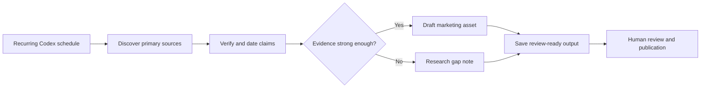

# feat: Launch monetization and marketing automation

## Summary

Launch Relay Index with a clear domain recommendation, an infrastructure-aligned monetization model, a production-quality pricing surface, and recurring Codex automation that covers three evidence-backed marketing workstreams. Keep publication, contact collection, billing and domain purchase deliberately human-controlled until the required external accounts exist.

---

## Problem Frame

Relay Index looks useful but has no visible commercial path and no repeatable system for turning verified A2A changes into launch material. The current agent manifest also contains placeholder claims, lint is not clean, and the test suite still targets the deleted starter skeleton.

---

## Assumptions

*This plan was authored without synchronous user confirmation. The items below are agent inferences that fill gaps in the input — un-validated bets that should be reviewed before implementation proceeds.*

- Domain purchase and DNS ownership remain user actions; the build may prepare for `relayindex.ai` but will not claim it is registered.
- The first commercial release publishes transparent tiers and pilot economics, but does not collect cards or claim billing is live because no payment account, tax posture or refund policy has been supplied.
- “Marketing automation crons” means recurring Codex automations that discover current A2A changes, produce cited draft assets, and write review-ready outputs. They do not publish, email, scrape leads or contact anyone.
- Each recurring run must treat public web sources as untrusted, use primary evidence where available, date every claim, distinguish fact from inference, and refuse to turn unverified claims into promotional copy.
- Sample intelligence in the site remains demo-only and is never used as evidence for the marketing drafts.

---

## Requirements

### Commercial launch

- R1. Validate brand-aligned domains against live registry data, recommend one primary domain, record current registrar price guidance and state that availability can change until purchase.
- R2. Define a hybrid subscription-plus-usage strategy that sells freshness, evidence, workflow and SLA without allowing sponsorship or payment to influence trust rankings.
- R3. Add an honest pricing and launch section with differentiated Public, Operator, Team and Enterprise tiers and no fake checkout or unavailable signup flow.

### Marketing automation

- R4. Create recurring Codex scheduling that covers a daily A2A change radar, a Tuesday/Thursday distribution pack and a Friday growth/monetization review. A single orchestrating heartbeat is acceptable when the current task supports only one attached recurring automation.
- R5. Make every automation evidence-first, citation-bearing, duplicate-aware and draft-only; save reusable outputs without external publication or personal-data processing.

### Public contracts and release quality

- R6. Correct the agent manifest and visible product copy so deployed URLs and capabilities match reality.
- R7. Replace stale starter tests, fix lint failures and verify homepage, pricing, manifest, API, capability detail and mobile behavior.
- R8. Commit, push, save and privately deploy the reviewed release.

---

## Scope Boundaries

- No domain purchase or custom-domain binding.
- No billing integration, card collection, tax handling, invoices or refunds.
- No email list, public lead form, cold outreach, contact enrichment or personal-data persistence.
- No automatic social posting, newsletters or webhook delivery.
- No pay-to-rank placements, purchased trust scores or campaign-engagement inputs in capability ranking.
- No claim that the seeded product data is live.

### Deferred to Follow-Up Work

- Register and bind `relayindex.ai` after the owner completes registrar checkout.
- Add checkout and metering after a billing provider and business policies are selected.
- Add consented lifecycle messaging only after a sender domain, delivery provider, double opt-in flow, unsubscribe contract, abuse controls and retention policy exist.
- Add transaction-based routing fees only after signed invocation receipts and dispute handling exist.

---

## Context & Research

### Relevant Code and Patterns

- `app/relay-dashboard.tsx` is the existing commercial surface and should retain its dark, restrained control-plane language.
- `lib/pipeline.ts` keeps discovery, verification, observation, ranking and signals replaceable; marketing research should mirror that evidence-first separation conceptually.
- `app/.well-known/agent.json/route.ts` hardcodes placeholder URLs and unsupported push/history capabilities.
- `tests/rendered-html.test.mjs` still asserts the removed starter skeleton and must become a product render test.
- `app/capabilities/[slug]/page.tsx` contains internal anchors that currently fail lint.

### Institutional Learnings

- No `docs/solutions/` or repository `AGENTS.md` exists.
- Local documentation requires live-source, signed-observation, API-key and rate-limit work before production intelligence may replace the sample environment.
- Document reviewers rejected an earlier overbuilt plan because it had no real scheduler, no live intelligence source, and unsafe anonymous marketing consent. The revised plan removes all automated delivery and PII, then uses native Codex scheduling for draft generation.

### External References

- RDAP.org documents the registry bootstrap method used for availability checks: https://about.rdap.org/
- Cloudflare Registrar supports `.ai` at registry/ICANN cost: https://www.cloudflare.com/products/registrar/
- Porkbun currently lists `.ai` registration and renewal at USD $72.40 before checkout-specific minimum-term or premium pricing: https://porkbun.com/tld/features
- Cloudflare documents Worker Cron Triggers, but the current Sites project metadata has no trigger-provisioning surface; native Codex automations are therefore the scheduler selected for this release: https://developers.cloudflare.com/workers/configuration/cron-triggers/

---

## Key Technical Decisions

- Recommend `relayindex.ai`: it matches the current brand and was unregistered in both RDAP and WHOIS checks on 2026-08-25. Defensive alternatives are `relayindex.dev`, `relayindex.io`, `relayindex.network` and `capabilityindex.ai`.
- Price the value layer, not the directory: Public keeps a delayed graph useful; Operator sells real-time watches and individual API quota; Team adds shared routing, webhooks and history; Enterprise adds private sources, custom scoring and SLA.
- Publish pilot pricing as a market test: Public $0, Operator $79/month, Team $399/month, Enterprise from $3,000/month. Include usage allowances and overage direction, while labeling billing as “pilot access” rather than live self-serve checkout.
- Reserve future revenue from successful delegation routing and provider audits, but keep both isolated from trust rankings and clearly outside the current product surface.
- Use Codex heartbeat/cron automation infrastructure instead of pretending the deployed Site can provision schedules it does not own.
- Automation outputs are drafts with source links and claim dates. A run that cannot verify a material claim produces a research note, not marketing copy.
- Normalize automation vocabulary to “A2A change radar,” “distribution pack,” and “growth/monetization review.”

---

## Planning Decisions and Open Questions

### Resolved During Planning

- Primary domain: `relayindex.ai`, subject to final registrar checkout.
- Commercial wedge: paid freshness, evidence depth, watches, API utility, collaboration and SLA.
- Scheduler: native recurring Codex automations that operate on current public evidence and save drafts locally.
- Distribution: human review and publication only.

### Deferred to Implementation

- Exact local output filenames may follow the automation tool’s project conventions as long as every run remains dated, source-linked and non-destructive.

---

## High-Level Technical Design

> *This illustrates the intended approach and is directional guidance for review, not implementation specification. The implementing agent should treat it as context, not code to reproduce.*

---

## Implementation Units

### U1. Domain and monetization launch surface

**Goal:** Make the domain recommendation, commercial model and upgrade path explicit without misrepresenting unfinished billing.

**Requirements:** R1, R2, R3

**Dependencies:** None

**Files:**
- Create: `docs/strategy/launch-and-monetization.md`
- Modify: `app/relay-dashboard.tsx`
- Modify: `app/globals.css`
- Test: `tests/rendered-html.test.mjs`

**Approach:**
- Document the availability evidence, registrar price guidance, purchase/binding handoff and defensive alternatives.
- Add Public, Operator, Team and Enterprise pricing with concrete limits, buyer outcomes and pilot-access language.
- Add a visible trust principle that commercial relationships cannot influence evidence or ranking.

**Patterns to follow:**
- Existing section rhythm, typography, metric cards and infrastructure language in `app/relay-dashboard.tsx`.

**Test scenarios:**
- Happy path: homepage output contains all tier names, prices, allowances and pilot boundary.
- Integrity: output contains the ranking-independence statement and no claim that checkout or the custom domain is live.
- Responsive: pricing grid and CTA remain readable without horizontal overflow on a narrow viewport.

**Verification:**
- A visitor can understand what Relay Index sells, which tier fits, what remains pilot-only and why the ranking stays credible.

### U4. Honest machine contracts and regression cleanup

**Goal:** Align the manifest and navigation with deployed reality, then replace obsolete tests.

**Requirements:** R6, R7

**Dependencies:** U1

**Files:**
- Modify: `app/.well-known/agent.json/route.ts`
- Modify: `app/capabilities/[slug]/page.tsx`
- Modify: `tests/rendered-html.test.mjs`
- Create: `tests/public-contracts.test.mjs`
- Modify: `README.md`

**Approach:**
- Resolve manifest URLs from a configured canonical origin or a strict allowlist of known Sites/custom hosts; never trust arbitrary forwarded host values.
- Remove unsupported push-notification and state-history claims.
- Replace internal anchors with the framework’s navigation component.
- Replace starter skeleton assertions with homepage, capability, API and manifest contracts.

**Execution note:** Write the contract assertions before modifying the manifest.

**Test scenarios:**
- Contract: the manifest advertises only implemented skills and the deployed origin.
- Security: hostile Host or forwarded-host values cannot produce attacker-controlled manifest URLs.
- Regression: homepage and representative capability detail server-render with record-specific metadata.
- API: capability endpoint remains clearly labeled `sample_demo`.
- Lint: internal navigation is framework-compatible and the project is lint-clean.

**Verification:**
- Human and agent visitors see the same truthful product boundary, with current tests covering the shipped interface.

### U6. Recurring marketing intelligence growth engine

**Goal:** Create real recurring scheduling that repeatedly produces review-ready, evidence-backed launch assets across three workstreams.

**Requirements:** R4, R5

**Dependencies:** U1

**Files:**
- Create: `docs/marketing/README.md`
- Create: `docs/marketing/templates/change-radar.md`
- Create: `docs/marketing/templates/distribution-pack.md`
- Create: `docs/marketing/templates/growth-review.md`

**Approach:**
- Daily A2A change radar: discover material capability/protocol/provider changes from primary sources, verify them and save a cited research brief.
- Twice-weekly distribution pack: transform the newest verified brief into concise newsletter, LinkedIn and X drafts without publishing.
- Weekly growth/monetization review: evaluate positioning, pricing, competitive signals and proposed experiments using current evidence and prior outputs.
- Configure a recurring Codex automation against this task, with notifications only for failures. Run the change radar daily; branch into distribution work on Tuesday/Thursday and growth review on Friday.

**Test scenarios:**
- Evidence: prompts require primary sources, claim dates, source links and explicit fact/inference separation.
- Integrity: prompts prohibit using the site’s sample records as live evidence.
- Safety: prompts prohibit external publishing, messaging, lead scraping and personal-data collection.
- Duplicate control: distribution automation reuses the newest verified brief and avoids reissuing the same angle without a material update.
- Failure path: insufficient evidence yields a research-gap note rather than invented promotional claims.

**Verification:**
- The active recurring engine covers all three workstreams with the requested weekday cadence and draft-only safeguards; no distribution branch runs without explicit human approval on its source brief.

### U5. Browser verification and Sites publish

**Goal:** Validate the commercial release end to end and deploy the exact reviewed source.

**Requirements:** R7, R8

**Dependencies:** U1, U4, U6

**Files:**
- Modify: `README.md`
- Modify: `docs/strategy/launch-and-monetization.md`

**Approach:**
- Run build, lint and route tests.
- Browser-test desktop/mobile pricing, navigation, manifest, API and capability detail.
- Commit and push the exact source, save a new Site version, deploy privately and reuse the existing Site tab.

**Test scenarios:**
- Browser: pricing navigation reaches the new tiers and mobile width has no horizontal overflow.
- Contract: manifest, API and capability detail return valid, truthful output.
- Regression: capability filtering, watch interaction and detail navigation continue to work.

**Verification:**
- All checks pass, automations are active, and the deployed Site contains the monetization release without regressions.

---

## System-Wide Impact

- **Interaction graph:** Site changes are presentational and contract-focused; recurring jobs operate in Codex against public sources and local marketing outputs.
- **Error propagation:** Unverified research stops at a gap note; it never becomes promotional copy or an external action.
- **State lifecycle risks:** Automation outputs are dated and additive; no production customer or contact state is created.
- **API surface parity:** Manifest and visible product copy describe only implemented capabilities.
- **Integration coverage:** Build/lint/tests plus browser checks cover the Site; automation tool inspection covers schedules and prompts.
- **Unchanged invariants:** Trust and evidence rankings remain independent of subscriptions, sponsorships, automation outputs and provider payments.

---

## Risks & Dependencies

| Risk | Mitigation |
|------|------------|
| Domain is purchased before checkout | Recommend immediate registration, retain alternatives and state the validation timestamp. |
| Pilot pricing is wrong | Treat prices as a measured launch hypothesis and review them weekly rather than wiring irreversible billing. |
| Automation drifts into generic AI content | Require primary evidence, material-change criteria and Relay Index-specific decision utility. |
| Generated copy contains unsupported claims | Require claim/source/date tables and route weak evidence to gap notes. |
| Users mistake sample site data for live intelligence | Preserve sample labels and prohibit automations from using demo records as evidence. |
| Marketing becomes a trust-ranking input | Keep automations outside the product ranking pipeline and state the invariant in copy and docs. |

---

## Documentation / Operational Notes

- Register `relayindex.ai` before public announcement; registrar checkout is the final authority on availability and premium pricing.
- Review automation outputs before publication. The crons produce drafts, not external actions.
- When billing is added, start with signed API usage and real-time watch value before introducing outcome-based routing fees.
- The existing social card remains valid; this incremental release does not need another generated image.

---

## Sources & References

- Related code: `app/relay-dashboard.tsx`, `app/.well-known/agent.json/route.ts`, `app/capabilities/[slug]/page.tsx`, `tests/rendered-html.test.mjs`
- RDAP lookup method: https://about.rdap.org/
- Cloudflare Registrar: https://www.cloudflare.com/products/registrar/
- Porkbun TLD pricing: https://porkbun.com/tld/features
- Cloudflare Cron Triggers: https://developers.cloudflare.com/workers/configuration/cron-triggers/
