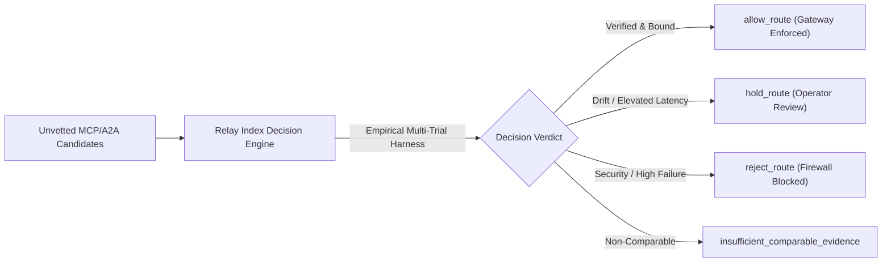
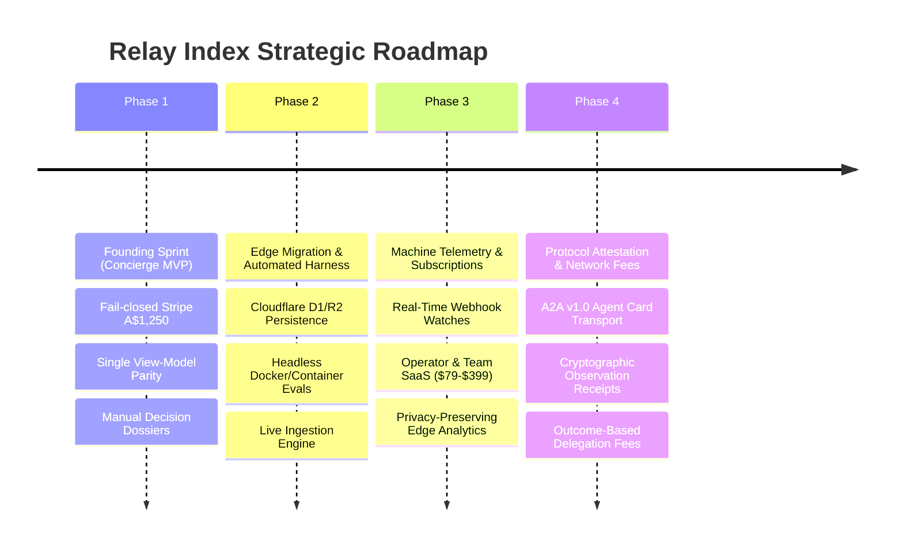

# Relay Index — Executive PRD: Vision & Scope

**Document Version:** `1.0.0`  
**Last Updated:** `2026-09-05`  
**Classification:** Strategic Requirements Specification  
**Status:** Canonical / Approved  

---

## 1. Executive Summary

**Relay Index** (`relayindex.dev`) is an **Agent Capability Decision Assurance Network**. It exists to solve the single largest operational friction point in the emerging multi-agent and tool ecosystem: **The Connection Dilemma**.

In a market rapidly populated by Model Context Protocol (MCP) servers, Agent-to-Agent (A2A) services, and autonomous tool APIs, finding a tool is trivial; deciding whether to permit an agent to connect to it in a production, mission-critical workflow is high-risk. Current infrastructure catalogs identities and scans static syntax, but fails to provide empirical, reproducible, workload-specific assurance.

Relay Index does not compete as a directory, scanner, or gateway. Instead, it provides **independent, task-specific decision assurance**: pre-registered, empirical evaluation of external candidates before connection approval, returning an unambiguous, evidence-backed outcome:
$$\text{Outcome} \in \{\texttt{allow\_route}, \texttt{hold\_route}, \texttt{reject\_route}, \texttt{insufficient\_comparable\_evidence}\}$$

---

## 2. The Core Problem: The Connection Dilemma

Today, engineering teams and autonomous agent runtimes face an asymmetric risk:

1. **Discovery is Solved, Qualification is Broken:** Aggregators and registries index thousands of tools. However, an entry in an MCP registry or an A2A Agent Card provides zero guarantee of p95 latency, real failure modes, authorization scope drift, pricing predictability, or runtime side effects.
2. **Static Scanning Misses Runtime Realities:** AST analysis and sandbox build tests (e.g., checking if an MCP server builds in a clean container) cannot reveal how an external service behaves under concurrency, whether upstream APIs throttle silently, or how long-running task delegations recover from failure.
3. **Internal APMs are Introspective, Not Predictive:** Observability tools (Arize, LangSmith, Datadog) record failures *after* an agent makes a disastrous external invocation. They do not pre-qualify candidates *before* the connection is allowed.
4. **Agent Hallucination of Capability:** Autonomous agents routinely select external tools based on optimistic semantic descriptions, resulting in runtime timeouts, cost blowouts, and data leakage.

---

## 3. Anti-Commoditization Positioning

Relay Index strictly rejects generic cataloging. To maintain defensive differentiation and enterprise pricing power, the system adheres to explicit category boundaries:

| Adjacent Category | Incumbents | Their Domain | Why Relay Index is NOT This |
| :--- | :--- | :--- | :--- |
| **Catalog / Directory** | Smithery, PulseMCP, GitHub Agent Finder | Aggregating manifests, SEO discovery, popularity metrics | Directories measure *what exists*; Relay Index measures *what performs under empirical trials*. |
| **Static Security Scanner** | Glama, Snyk, Socket | AST linting, manifest parsing, container vulnerability | Scanners test *build safety*; Relay Index verifies *runtime workload fidelity, latency, and auth boundaries*. |
| **AI Gateway / Proxy** | Solo.io (agentgateway), Gravitee, Cloudflare AI Gateway | Token rate limiting, reverse proxy, credential injection | Gateways *enforce rules*; Relay Index *generates the empirical proof packets* that define those rules. |
| **Agent Observability / APM** | Arize, Braintrust, LangSmith | Private internal telemetry, prompt tracing, evals | Observability tracks *first-party telemetry*; Relay Index evaluates *third-party external candidates*. |

> [!IMPORTANT]
> **Defensive Wedge Definition:**  
> Relay Index is an **independent decision layer**. Registries are ingestion sources; gateways are policy enforcement partners; APMs are telemetry contributors. Relay Index occupies the high-value evaluation bottleneck that occurs immediately prior to corporate gateway allowlisting.

---

## 4. User Personas & Value Proposition

### Persona 1: The Enterprise Platform & Security Architect
* **Profile:** Responsible for engineering workstation security, enterprise agent tooling, and corporate data boundaries.
* **Pain Point:** Developers and AI assistants connect arbitrary MCP servers locally, exposing internal codebases to unvetted tools with untracked authorization scopes.
* **Value Received:** Standardized, citable **Decision Packets** delivering hard evidence of authorization boundaries, data egress points, and reproducible stability before corporate allowlisting.

### Persona 2: The Autonomous Agent Orchestrator
* **Profile:** Operates production agent swarms requiring automated delegation to external specialist agents via A2A or MCP.
* **Pain Point:** Needs programmatic routing decisions based on real-time empirical p95 latency, cost basis, and error budgets rather than marketing claims.
* **Value Received:** Machine-readable endpoint contracts ([`GET /api/v1/offers/capability-assurance`](file:///home/ae/Documents/Codex/2026-08-25/referenced-chatgpt-conversation-this-is-an/work/site/app/api/v1/offers/capability-assurance/route.ts)) emitting machine-digestible decision vectors and cryptographically signed observations.

### Persona 3: The High-Integrity Tool/Agent Provider
* **Profile:** Builds professional-grade MCP tools and wants enterprise adoption without competing in pay-to-win directory spam.
* **Pain Point:** Buried in directories beneath unmaintained open-source experiments with purchased upvotes.
* **Value Received:** Independent, verifiable third-party certification where rankings are derived strictly from empirical uptime, latency, and conformance observations.

---

## 5. Non-Negotiable System Invariants: The Credibility Firewall

The commercial survival of Relay Index depends entirely on objective neutrality. The following axioms are permanently enforced in software, data pipelines, and operational policy:

1. **The Separation of Revenue and Ranking:**  
   Under no circumstances can payment, subscription tier, sponsorship, or consulting engagement alter a capability's trust score, latency metric, or positioning in resolution results.
2. **Neutrality of Negative and Insufficient Findings:**  
   A decision packet that concludes $\texttt{reject\_route}$ or $\texttt{insufficient\_comparable\_evidence}$ is considered a 100% successful delivery. Paid provider audit fees purchase rigorous evaluation effort, never approval.
3. **No Uninstrumented Fluff:**  
   Every claim, metric, and ranking displayed on the public control plane or emitted via API must be directly traceable to a dated, signed observation or a cited primary source.
4. **Draft-Only Growth Engine:**  
   Automated research agents may discover market gaps and draft distribution materials, but they possess zero write authority to production databases, public social APIs, or live email channels without cryptographically signed human approval.
5. **Fail-Closed Financial & Contract Gates:**  
   If payment configurations, Stripe links, or verification keys are absent or unverified, the system must fail closed—disabling transaction buttons and marking status explicitly rather than faking availability.

---

## 6. Strategic Scope & Milestones

* **Phase 1 (Current Baseline):** Grounded manual proof sprints (A$1,250), single view-model parity across UI/API ([`lib/offer.ts`](file:///home/ae/Documents/Codex/2026-08-25/referenced-chatgpt-conversation-this-is-an/work/site/lib/offer.ts)), hardened canonical origin enforcement, and external Codex research automation.
* **Phase 2 (Immediate Target):** Complete transition from Porkbun DNS to Cloudflare edge; deploy Cloudflare D1 for capability storage and R2 for evidence dossiers; implement automated synthetic probe runners replacing the manual testing burden.
* **Phase 3 (Expansion):** Launch self-serve subscription tiers for real-time change radar webhooks; wire zero-cookie edge telemetry; establish the CLI-driven distribution approval engine.
* **Phase 4 (Maturity):** Implement conforming A2A v1.0 Agent Cards and bilateral cryptographic receipts for delegated autonomous agent micro-routing.
