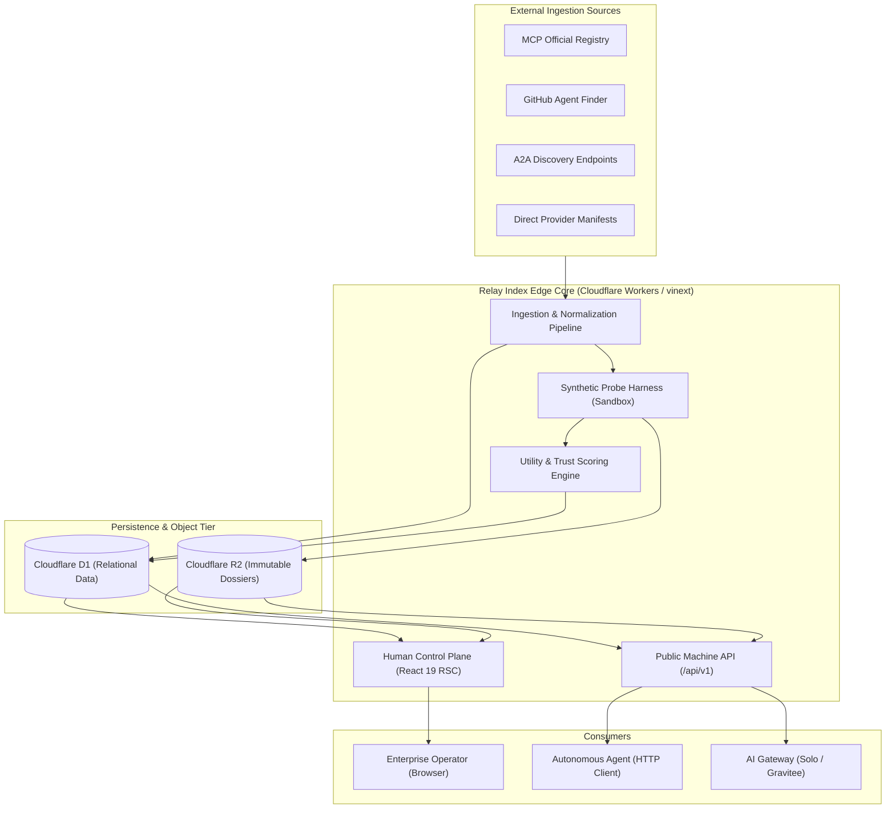
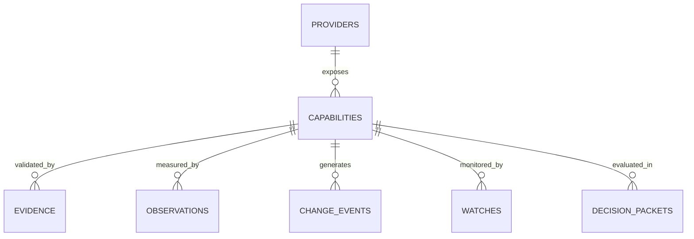
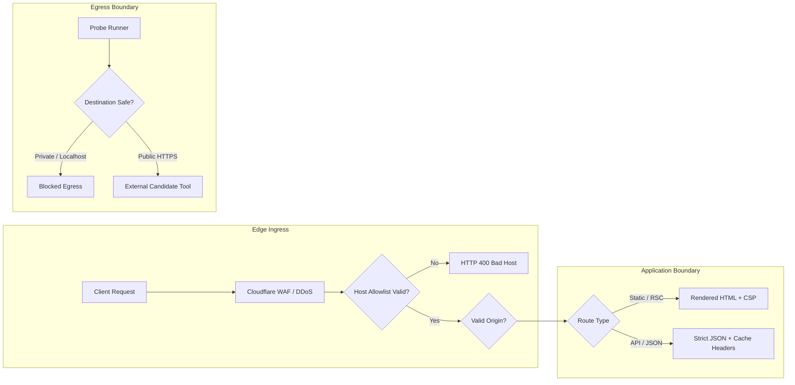

# Relay Index — System Architecture & Topology

**Document Version:** `1.0.0`  
**Last Updated:** `2026-09-05`  
**Classification:** Technical Architecture Specification  
**Status:** Canonical / Approved  

---

## 1. Architectural Philosophy

Relay Index is architected as an **Edge-First, Asymmetric Dual-Plane System**:
1. **The Human Control Plane:** A high-density, low-latency, avant-garde operational dashboard optimized for cognitive clarity, visual hierarchy, and fast operator decisions.
2. **The Agent Control Plane:** A deterministic, ultra-low-latency, machine-readable HTTP/JSON interface providing strict schema contracts, canonical provenance links, and zero-hallucination decision parameters.

Both planes are underpinned by a shared, immutable domain model executed on globally distributed V8 isolates.



---

## 2. Infrastructure & Hosting Topology

### 2.1 Runtime Platform: Cloudflare Workers & `vinext`
* **Runtime:** Cloudflare Edge V8 isolates utilizing `vinext` (Next.js 16/React 19 on Vite runtime).
* **Execution Footprint:** Zero Node.js cold-start latency; sub-30ms global execution time across 300+ edge locations.
* **Compatibility Layer:** Strict conformance to Web Standard APIs (`fetch`, `Request`, `Response`, `URL`, `Crypto`). Native Node.js modules (`fs`, `child_process`, `net`) are forbidden in edge-rendered paths.

### 2.2 Domain & DNS Ingress Configuration
The system resolves the DNS parking discrepancy recorded in previous audits:
* **Authoritative Domain:** `relayindex.dev`
* **Authoritative DNS Zone:** Migrated to Cloudflare DNS with universal SSL/TLS enabled.
* **Ingress Firewall:**
  * Strict canonical host allowlist enforced at the edge: only requests targeting `relayindex.dev` or authorized internal staging hosts (`*.chatgpt-team.site`) are served.
  * Untrusted or hostile `Host` and `X-Forwarded-Host` headers are rejected with HTTP 400.

---

## 3. Storage & Persistence Tier

The persistence layer separates structured querying from immutable proof retention:



### 3.1 Cloudflare D1 (Relational Metadata Store)
D1 provides transactional SQLite at the edge for relational filtering, pagination, and real-time graph traversal:
* `providers`: Identifier, name, cryptographic public key, verified protocol list (`MCP`, `A2A`, `REST`), region.
* `capabilities`: Slug, name, provider reference, protocol interfaces, 30-day reliability, p50/p95 latency, trust score, confidence score.
* `change_events`: Protocol changes, pricing drift, schema additions, breaking interface deprecations.
* `watches`: User-configured triggers for webhook dispatch when capability status changes.

### 3.2 Cloudflare R2 (Immutable Evidence Store)
R2 provides S3-compatible, globally distributed object storage for large, non-relational audit artifacts:
* `dossiers/{decision_id}.json`: Complete, pre-registered decision matrices with raw outputs, execution timestamps, and cryptographic digests.
* `traces/{observation_id}.zst`: Compressed raw payload traces of synthetic test calls (sanitized of sensitive tokens).
* `manifests/{provider_id}/{version}.json`: Historical snapshots of upstream Agent Cards and MCP schemas for drift detection.

---

## 4. Subsystem Specifications

### 4.1 Ingestion & Normalization Pipeline
* **Cadence:** Scheduled cron workers executing at 6-hour intervals.
* **Source Adapters:** Pluggable interface (`lib/pipeline.ts`) isolating provider-specific schemas:
  ```typescript
  export interface IngestionAdapter {
    id: string;
    protocol: "MCP" | "A2A" | "REST";
    poll(): Promise<NormalizedCapabilityManifest[]>;
    fingerprint(raw: unknown): string;
  }
  ```
* **Drift Detection:** Compares incoming manifest SHA-256 fingerprints against stored historical records. Any modification generates a dated `ChangeEvent` with classified severity (`low`, `medium`, `high`).

### 4.2 Synthetic Probe Harness
* **Execution Boundary:** Sandboxed, ephemeral execution containers (Cloudflare Browser Rendering / Isolated Workers or private container runners).
* **Protocol Isolation:** Executes tool calls across isolated test fixtures without network access to corporate internal networks.
* **Measurement Rules:**
  * Runs minimum 10 identical trials per candidate workload.
  * Separates initial connection handshake from repeated invocations.
  * Records wall-clock latency, billable tokens, failure categories, and payload sizes.

### 4.3 Utility & Trust Scoring Engine
* **The Scoring Invariant:** Trust is a mathematical function of reproducible evidence and time decay; it is never manually assigned or purchased.
* **The Utility Function:**
  $$U(c) = w_{\text{rel}} \cdot R_{30}(c) + w_{\text{lat}} \cdot \left(1 - \frac{L_{p95}(c)}{L_{\max}}\right) + w_{\text{conf}} \cdot C(c) - w_{\text{risk}} \cdot \Delta_{\text{drift}}(c)$$
  Where:
  * $R_{30}(c)$ is 30-day observed availability $[0, 1]$.
  * $L_{p95}(c)$ is the 95th percentile latency in milliseconds.
  * $C(c)$ is the sample-size confidence factor: $C(c) = 1 - \frac{1}{\sqrt{N + 1}}$.
  * $\Delta_{\text{drift}}(c)$ is the cumulative penalty for unannounced breaking changes within the trailing 90 days.
  * Evidence decays over time via exponential half-life: $E_{\text{eff}}(t) = E_0 \cdot e^{-\lambda t}$.

---

## 5. Security & Boundary Architecture



1. **Host Header Poisoning Defense:** Built upon [`lib/public-origin.ts`](file:///home/ae/Documents/Codex/2026-08-25/referenced-chatgpt-conversation-this-is-an/work/site/lib/public-origin.ts), dynamically constructing absolute URLs only against validated canonical origins.
2. **Server-Side Request Forgery (SSRF) Protection:** Probe runners resolving candidate tool endpoints strictly forbid IP ranges in `127.0.0.0/8`, `10.0.0.0/8`, `172.16.0.0/12`, `169.254.0.0/16` (metadata service), and `192.168.0.0/16`.
3. **Fail-Closed Financial Gate:** Evaluated in [`lib/checkout.ts`](file:///home/ae/Documents/Codex/2026-08-25/referenced-chatgpt-conversation-this-is-an/work/site/lib/checkout.ts); checkout is permanently disabled unless a valid, whitelisted Stripe host (`https://buy.stripe.com/*`) is cryptographically verified in runtime environment configuration.
