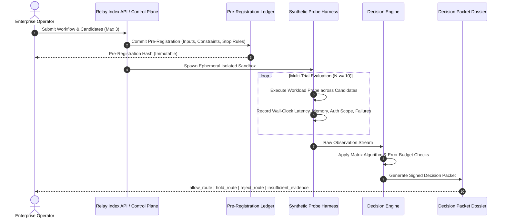
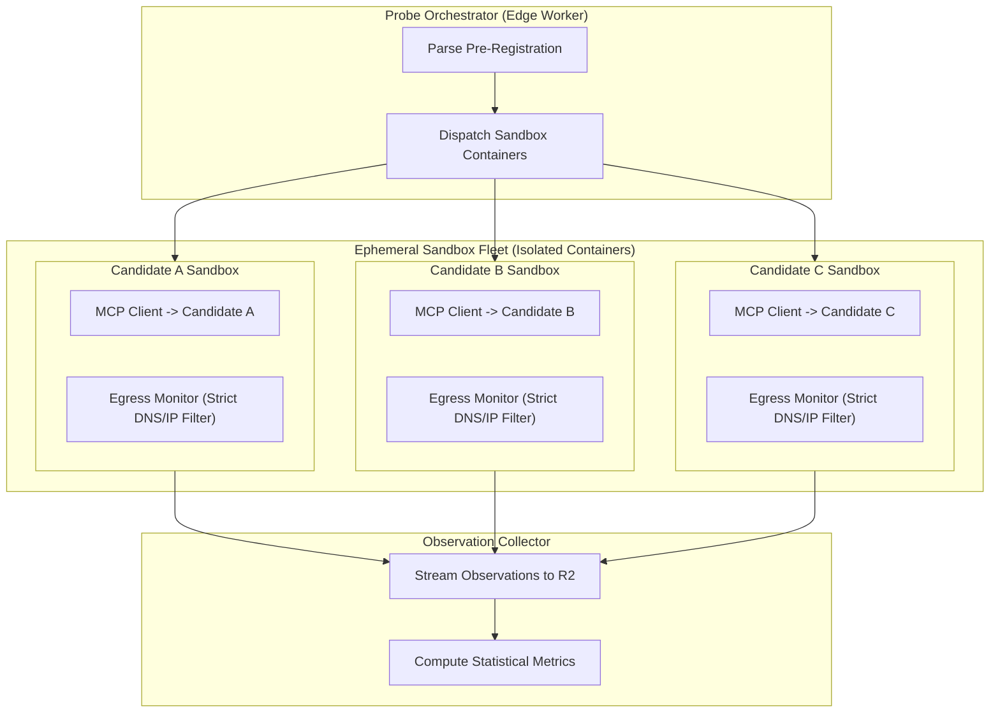
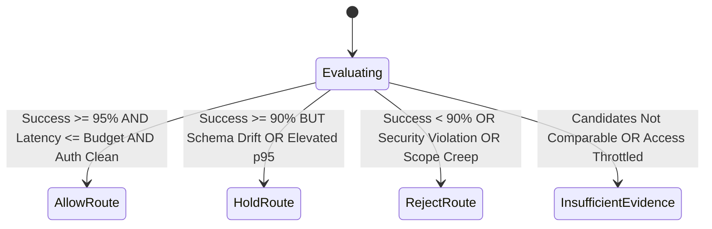

# Relay Index — Decision Assurance Engine Specification

**Document Version:** `1.0.0`  
**Last Updated:** `2026-09-05`  
**Classification:** Core Engine Functional Specification  
**Status:** Canonical / Approved  

---

## 1. The Core Product Wedge

The **Decision Assurance Engine** is the central economic and functional engine of Relay Index. It exists to replace subjective engineering debates and directory upvotes with **empirical, reproducible connection verdicts**.

When an engineering organization connects an external Model Context Protocol (MCP) server or A2A autonomous agent into an enterprise orchestrator, the Decision Engine evaluates candidate tools under rigorous, pre-registered constraints to answer a single question:  
*“Should we allow this connection, hold for review, reject it, or acknowledge that evidence is insufficient?”*



---

## 2. Intake & Pre-Registration Protocol

To guarantee absolute scientific integrity and eliminate post-hoc rationalization, no evaluation can commence without a sealed pre-registration. This mirrors the specifications codified in [`lib/offer.ts`](file:///home/ae/Documents/Codex/2026-08-25/referenced-chatgpt-conversation-this-is-an/work/site/lib/offer.ts).

### 2.1 Pre-Registration Input Parameters
1. **Workflow Name & Purpose:** A single, concrete functional task (e.g., `"Query Postgres via Natural Language"`, `"Execute GitHub Pull Request Review"`).
2. **Candidate Boundary:** Exactly 1 to 3 candidate servers, tools, or current routes.
3. **Representative Input Vectors:** Safe, non-production test inputs exercising edge cases (e.g., malformed parameters, boundary limits).
4. **Declared Constraints:**
   * Maximum acceptable p95 latency: $L_{\max}$.
   * Maximum cost per 1k invocations: $C_{\max}$.
   * Strict authorization boundaries: Maximum permissible OAuth/token scopes.
   * Required output schema conformance: JSON Schema definition.
5. **Stop Rules:** Explicit pre-committed thresholds where evaluation halts immediately (e.g., tool attempts unauthorized network egress).

---

## 3. Evaluation Execution Rules

The synthetic probe runner executes trials under strict deterministic rules:

### Rule 1: Multi-Trial Baseline ($N \ge 10$)
Each candidate must undergo a minimum of 10 identical, independent trial invocations under uniform network conditions.

### Rule 2: Cold-Start vs Warm Execution Separation
The first invocation (warmup / handshake / container boot) is recorded as a dedicated $\text{Trial}_0$ and is never blended into steady-state p50 or p95 statistics.

### Rule 3: Explicit Failure Attribution
Failures are never silently masked or retried out of existence:
* A maximum of two transient retries (network drop, TCP RST) are allowed per trial.
* Transient retries are explicitly logged in the raw observation packet.
* Unhandled HTTP 5xx, schema mismatch, parameter rejection, or timeout are permanent trial failures.

### Rule 4: Latency & Cost Calculation
* **Latency:** Measured via high-resolution monotonic timer (`performance.now()`). Both Median (p50) and 95th Percentile (p95) are calculated.
* **Cost Basis:** Calculated as:
  $$\text{Cost} = \text{Fixed Tool Invocation Fee} + (\text{Observed Input Tokens} \times P_{\text{in}}) + (\text{Observed Output Tokens} \times P_{\text{out}})$$
  Pricing must be grounded in dated, published provider price sheets.

---

## 4. The Automated Probe Harness Architecture

While founding proof sprints are executed via verified concierge protocols, the engine is architected for autonomous execution:



1. **Ephemeral Sandboxes:** Isolated micro-VMs or WebAssembly runtimes spin up per evaluation run and terminate immediately upon completion.
2. **Egress Firewalling:** Candidate tools are executed under strict packet capture. Any attempt to contact undeclared external IPs triggers an instant security flag.
3. **AST & Tool Diffing:** The harness automatically diffs the candidate's declared tool schemas against the actual runtime response payloads to detect unannounced schema drift.

---

## 5. Decision Verdict Taxonomy

The Decision Engine synthesizes multi-trial observations into one of four immutable verdicts:



### 1. `allow_route`
* **Conditions:**
  * Trial Success Rate $\ge 95\%$.
  * Median and p95 latency within pre-registered budget.
  * Zero unauthorized scope escalation or undeclared network egress.
  * Output adheres $100\%$ to declared JSON schema.
* **Operational Action:** Certified for immediate production gateway routing.

### 2. `hold_route`
* **Conditions:**
  * Core functional workload succeeds, but secondary risk factors emerge.
  * Unannounced schema additions or parameter deprecations detected.
  * p95 latency exhibits high jitter ($> 2.5\times$ median).
* **Operational Action:** Requires human operator sign-off before production connection.

### 3. `reject_route`
* **Conditions:**
  * Trial Failure Rate $> 10\%$.
  * Security violation: Attempted access to local filesystem, metadata IP, or unlisted domains.
  * Unauthorized privilege escalation detected.
* **Operational Action:** Added to enterprise gateway blocklist.

### 4. `insufficient_comparable_evidence`
* **Conditions:**
  * Candidates lack equivalent functional APIs for a fair comparison.
  * Upstream rate limits or authentication blockers prevented completing 10 trials.
* **Operational Action:** Impartial, neutral verdict. The report documents why an empirical comparison could not be established.

---

## 6. The Decision Packet Dossier

The final deliverable of an assurance evaluation is an immutable, cryptographically signed JSON dossier stored in Cloudflare R2 and rendered in the operator dashboard:

```json
{
  "schema_version": "1.0.0",
  "decision_id": "dec_01J7Z8M4X9PQ2W3E5R6T7Y8U9I",
  "workflow": "Execute Database Schema Migration via MCP",
  "timestamp": "2026-09-05T13:30:00Z",
  "verdict": "allow_route",
  "primary_recommendation": "candidate_supabase_mcp_v2",
  "confidence_score": 0.94,
  "matrix": [
    {
      "candidate_id": "candidate_supabase_mcp_v2",
      "trials_completed": 10,
      "success_rate": 1.0,
      "latency_p50_ms": 142.5,
      "latency_p95_ms": 188.0,
      "cost_per_run_usd": 0.0012,
      "auth_risk": "low",
      "verdict": "allow_route"
    },
    {
      "candidate_id": "candidate_prisma_mcp_unofficial",
      "trials_completed": 10,
      "success_rate": 0.7,
      "latency_p50_ms": 480.2,
      "latency_p95_ms": 1450.0,
      "cost_per_run_usd": 0.0035,
      "auth_risk": "high",
      "verdict": "reject_route"
    }
  ],
  "disconfirming_signals": [
    "Provider released beta v2.1 with unannounced OAuth2 changes on 2026-09-04."
  ],
  "signature": "ed25519:3b9f8d...c4a1e7"
}
```
