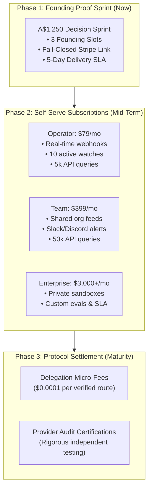
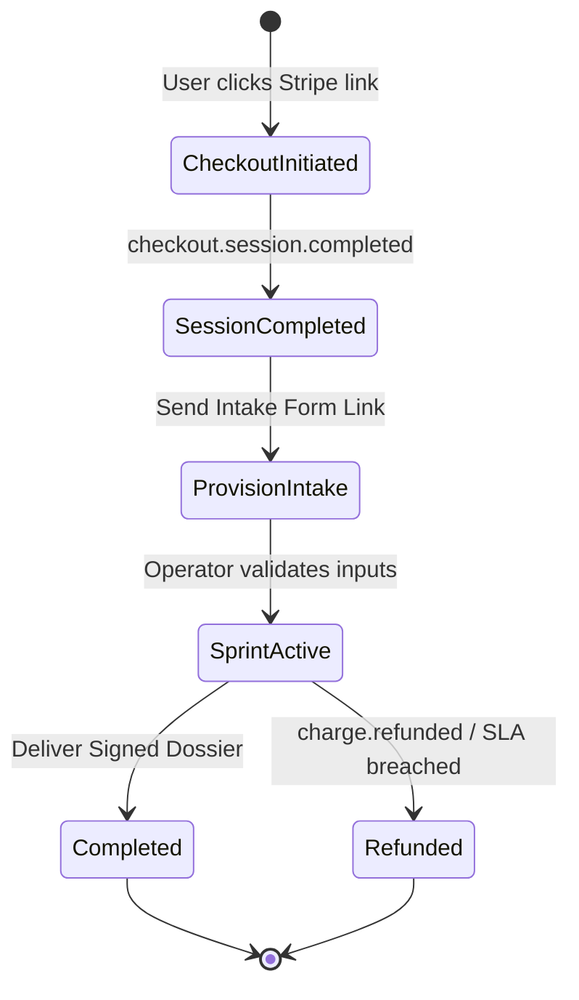
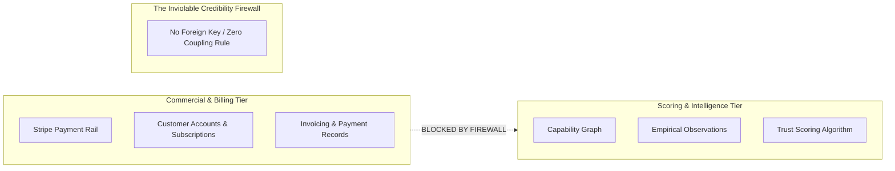

# Relay Index — Commercial & Billing Engine Specification

**Document Version:** `1.0.0`  
**Last Updated:** `2026-09-05`  
**Classification:** Commercial & Financial Engineering Specification  
**Status:** Canonical / Approved  

---

## 1. Commercial Architecture & Revenue Evolution

Relay Index monetizes the **cost of consequential routing decisions**. In an enterprise environment, connecting the wrong tool causes data leaks, billing runaway, or downtime. Organizations will pay to derisk that decision.

The commercial roadmap is structured across three deliberate phases, transitioning from manual validation to protocol automation:

---

## 2. Phase 1: Founding Proof Sprint (Immediate Implementation)

The founding offer is an explicit, evidence-backed commercial experiment codified in [`lib/offer.ts`](file:///home/ae/Documents/Codex/2026-08-25/referenced-chatgpt-conversation-this-is-an/work/site/lib/offer.ts) and [`docs/strategy/launch-and-monetization.md`](file:///home/ae/Documents/Codex/2026-08-25/referenced-chatgpt-conversation-this-is-an/work/site/docs/strategy/launch-and-monetization.md).

### 2.1 Pricing & Terms
* **Price:** $\text{A}\$1,250 \text{ AUD}$ (One-time engagement fee).
* **Capacity Limit:** Capped at 3 founding enterprise slots.
* **Delivery Target:** 5 business days after receipt of valid workflow parameters and test access.
* **Payment Rail:** Stripe Payment Links via standard Australian pricing ($1.7\% + 30\text{c}$ domestic card fee; zero fixed monthly platform cost).

### 2.2 Fail-Closed Architectural Gate
Under [`lib/checkout.ts`](file:///home/ae/Documents/Codex/2026-08-25/referenced-chatgpt-conversation-this-is-an/work/site/lib/checkout.ts), the application fails closed to protect trust:
* If `NEXT_PUBLIC_RELAY_PILOT_CHECKOUT_URL` is empty, malformed, or targets any host other than `buy.stripe.com`, checkout is disabled across all UI and API surfaces.
* Buttons display `"See the offer"` instead of `"Buy the sprint"`, and the JSON contract returns `billing.checkout_enabled: false`.

### 2.3 Required Legal & Commercial Policies
Before opening live checkout, the Stripe product configuration must mandate:
1. **Legal Entity & GST:** Explicit Australian Business Number (ABN) disclosure and GST treatment (`shown_at_checkout`).
2. **Refund Guarantee:** $100\%$ refund if Relay Index cannot deliver the decision dossier within 5 business days, or if legal/security constraints prevent lawful candidate testing.
3. **Post-Payment Intake Flow:** Stripe `success_url` redirects the buyer to a secure intake form collecting:
   * Workflow specification.
   * Candidate endpoints/schemas (max 3).
   * Safe test credentials or public endpoints.
   * Explicit authorization to conduct probe trials.

---

## 3. Phase 2: Self-Serve Subscriptions & Machine Quotas

Once founding sprints prove repeatable willingness-to-pay, Relay Index will open automated monthly subscription tiers managed via Stripe Customer Portal:

| Dimension | Public Tier | Operator Tier | Team Tier | Enterprise Tier |
| :--- | :--- | :--- | :--- | :--- |
| **Monthly Fee** | $\text{Free}$ | $\text{US}\$79/\text{mo}$ | $\text{US}\$399/\text{mo}$ | $\text{From US}\$3,000/\text{mo}$ |
| **Graph Freshness** | Delayed (24h) | Real-time (6h sync) | Real-time (<1h sync) | Continuous live telemetry |
| **API Quota** | $100\text{ req/day}$ | $5,000\text{ req/mo}$ | $50,000\text{ req/mo}$ | Custom / Dedicated |
| **Active Watches** | Local browser only | $10\text{ Cloud Watches}$ | $50\text{ Cloud Watches}$ | Unlimited |
| **Notification Rails**| None | Webhook, Email | Webhook, Slack, PagerDuty | SIEM / Kafka streaming |
| **Assurance Sprints** | None | Pay-as-you-go | $1\text{ Included/quarter}$ | Dedicated monthly evals |

---

## 4. Phase 3: Protocol Settlement & Attestation Fees

At ecosystem maturity, Relay Index captures value directly from agent execution flows:

1. **Outcome-Based Delegation Routing Fees:**
   * When an autonomous agent queries Relay Index for an optimal route and successfully executes a task, a fractional fee (e.g., $0.05\%$ of compute value or flat $\$0.0001$) is settled via cryptographic micropayments.
   * Requires signed invocation receipts and dispute handling protocols.

2. **Provider Verification Audits:**
   * MCP server or A2A agent developers pay a fixed certification fee for an exhaustive, public conformance audit.
   * **The Non-Negotiable Firewall Rule:** Payment purchases *the verification effort and audit compute*. It does not guarantee approval. If a paying provider fails the security or latency harness, the resulting public verdict is $\texttt{reject\_route}$ or $\texttt{hold\_route}$. Fees are non-refundable.

---

## 5. Stripe Webhook Lifecycle & State Machine

### Webhook Event Handlers (`POST /api/webhooks/stripe`)
* `checkout.session.completed`:
  * Validates Stripe cryptographic signature (`stripe-signature`).
  * Extracts customer email, transaction ID, and metadata.
  * Creates an unfulfilled sprint record in D1 with status `awaiting_intake`.
  * Dispatches intake email and triggers local operator notification.
* `charge.refunded`:
  * Updates sprint record status to `refunded`.
  * Logs cancellation reason to internal audit trail.

---

## 6. The Monetization Firewall

To prevent corruption of ranking integrity, billing and telemetry are kept physically and logically separate:

* **No Shared Foreign Keys:** The database tables powering scoring (`capabilities`, `evidence`, `observations`) contain zero columns referencing `customer_id`, `stripe_subscription_id`, or `revenue_amount`.
* **Zero Trust Bias:** The mathematical utility function $U(c)$ defined in the System Architecture has no coefficient for customer relationship, commercial spend, or sponsorship.
