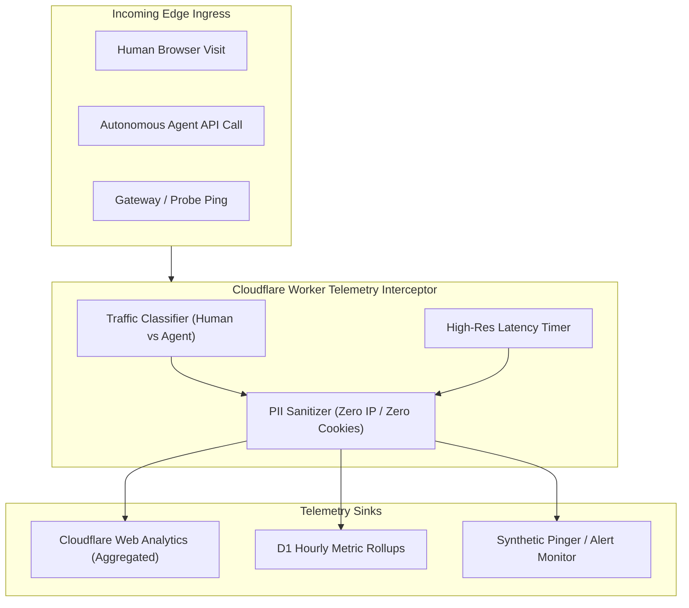
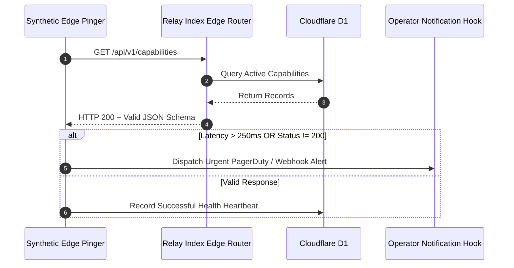

# Relay Index — Telemetry, Observability & System Health

**Document Version:** `1.0.0`  
**Last Updated:** `2026-09-05`  
**Classification:** Infrastructure & Operations Specification  
**Status:** Canonical / Approved  

---

## 1. Executive Context: Eliminating Telemetry Blindness

The [2026-09-04 Growth Review](file:///home/ae/Documents/Codex/2026-08-25/referenced-chatgpt-conversation-this-is-an/outputs/relay-index-automation/2026-09-04-growth-review.md) established that Relay Index suffered from **Total Telemetry Blindness**:
```
Verified capability resolutions: not instrumented
Watch-to-action conversion: not instrumented
Public API calls by unique agent: not instrumented
Pilot page views and offer-endpoint reads: not instrumented
Checkout starts, purchases, refunds: not instrumented
```

Without empirical measurement of its own platform, Relay Index cannot validate buyer demand, optimize API caching, or detect malicious traffic.

This specification establishes a **Zero-Cookie, Privacy-Preserving Edge Telemetry Architecture** providing complete observability across both the Human Control Plane and the Agent Control Plane.



---

## 2. Privacy-Preserving Data Collection Policy

Relay Index rejects predatory user tracking. The telemetry engine complies strictly with GDPR, CCPA, and ePrivacy regulations by eliminating client-side storage:
1. **Zero Client Cookies:** No tracking cookies, session identifiers, or local storage tracking tokens are set.
2. **Zero IP Storage:** IP addresses are processed in ephemeral memory solely for coarse geographic routing (country/region code) and DDoS rate limiting; raw IPs are never persisted to disk or D1.
3. **No Fingerprinting:** Canvas inspection, hardware enumeration, and browser fingerprinting are strictly prohibited.

---

## 3. The Core Telemetry Event Model

Edge workers log discrete, structured telemetry events directly to Cloudflare D1 rollups via asynchronous non-blocking background tasks (`ctx.waitUntil()`):

```typescript
export interface EdgeTelemetryEvent {
  eventId: string;
  timestamp: string;               // ISO 8601 UTC
  eventType: 
    | "page_view"                  // Human dashboard visit
    | "offer_read"                 // Machine reading offer contract
    | "catalog_query"              // Invocations of /api/v1/capabilities
    | "watch_toggled"              // Local or cloud watch state change
    | "checkout_initiated"         // Click on buy.stripe.com link
    | "decision_evaluated";        // Invocations of decision engine
  clientKind: "human_browser" | "ai_agent" | "unknown";
  path: string;                    // Normalized request path
  status: number;                  // HTTP status code
  latencyMs: number;               // Monotonic edge execution time
  country: string;                 // ISO 3166-1 alpha-2 country code
  userAgentFamily: string;         // e.g., "Chrome", "Python-Requests", "Claude-User"
}
```

### Human vs. Agent Traffic Disambiguation
The edge interceptor classifies traffic using header heuristics:
* **`ai_agent`:** Requests carrying `Accept: application/json`, known AI user agents (`Claude-Web`, `GPTBot`, `LangChain`, `curl`), or explicit authorization tokens.
* **`human_browser`:** Requests requesting `text/html` with standard browser `Sec-CH-UA` client hint headers.

---

## 4. Service Level Objectives (SLOs) & Error Budgets

To serve as enterprise infrastructure for mission-critical agent routing, Relay Index enforces strict reliability targets:

| Metric | Target (SLO) | Measurement Window | Action on Breach |
| :--- | :--- | :--- | :--- |
| **API Availability** | $\ge 99.9\%$ | Rolling 30 days | Automated edge failover to static cache |
| **Edge API Latency (p95)** | $\le 120\text{ ms}$ | Trailing 1 hour | Optimize D1 indices / stale cache warmup |
| **Edge API Latency (p99)** | $\le 250\text{ ms}$ | Trailing 1 hour | Alert on-call operator |
| **Edge 5xx Error Rate** | $\le 0.05\%$ | Trailing 15 minutes | Trigger emergency rollback to prior commit |
| **Stripe Gateway Integrity** | $100\%$ | Instantaneous | Auto-disable buy buttons on malformed URL |

---

## 5. Synthetic Probe & Continuous Health Monitoring

A dedicated Cloudflare Cron Trigger executes every 5 minutes from multiple worldwide edge regions to verify system integrity:



### Health Check Verifications
1. **Catalog Integrity:** Validates that `GET /api/v1/capabilities` returns valid JSON with `schema_version: "1.0.0"`.
2. **Offer Parity:** Validates that `GET /api/v1/offers/capability-assurance` matches the static hash of [`lib/offer.ts`](file:///home/ae/Documents/Codex/2026-08-25/referenced-chatgpt-conversation-this-is-an/work/site/lib/offer.ts).
3. **Canonical Host Defense:** Verifies that spoofed `Host: evil.com` requests receive `HTTP 400 Bad Request`.
4. **Checkout URL Health:** Verifies that the configured Stripe URL (if enabled) responds with valid Stripe checkout TLS headers.

---

## 6. Incident Management & Automated Rollback

If edge telemetry detects an active SLO breach:
1. **Automated Static Fallback:** If Cloudflare D1 becomes unreachable or returns read timeouts, the Worker automatically falls back to serving a static snapshot of the capability graph cached in Cloudflare KV / edge memory, preserving read availability with a `data_stale: true` header flag.
2. **Immediate Rollback Execution:** If a new software deployment results in a 5xx error rate $> 1\%$, the deployment pipeline automatically invokes Cloudflare API rollback to restore the previous known-good deployment version.
