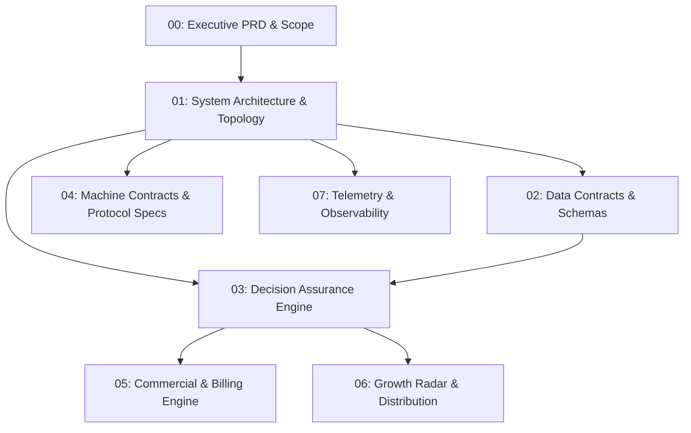

# Relay Index — Requirements Specification Suite

**Suite Version:** `1.0.0`  
**Last Updated:** `2026-09-05`  
**System Classification:** Production Software Requirements Specification (SRS) & PRD  
**Domain Authority:** `relayindex.dev`  

---

## 1. Executive Overview

This directory contains the canonical, production-grade requirements and architectural specifications for **Relay Index** (`relayindex.dev`), the **Agent Capability Decision Assurance Network**.

Relay Index addresses **The Connection Dilemma**: while discovering Model Context Protocol (MCP) servers and Agent-to-Agent (A2A) services is solved by directories, deciding whether an enterprise agent should be permitted to connect to them in high-consequence production workflows requires independent, empirical, reproducible decision assurance.

---

## 2. Requirements Document Suite Index

| Document | Title | Core Focus | Target Audience |
| :--- | :--- | :--- | :--- |
| [**`00-EXECUTIVE-PRD`**](file:///home/ae/Documents/Codex/2026-08-25/referenced-chatgpt-conversation-this-is-an/work/site/docs/requirements/00-EXECUTIVE-PRD-VISION-AND-SCOPE.md) | Executive PRD: Vision & Scope | Strategic mission, category anti-commoditization, user personas, credibility invariants. | Founders, Product Leads, Architects |
| [**`01-SYSTEM-ARCHITECTURE`**](file:///home/ae/Documents/Codex/2026-08-25/referenced-chatgpt-conversation-this-is-an/work/site/docs/requirements/01-SYSTEM-ARCHITECTURE-AND-TOPOLOGY.md) | System Architecture & Topology | Cloudflare edge runtime, D1/R2 storage, synthetic probe harness, security boundaries. | Principal Engineers, DevOps |
| [**`02-CORE-DATA-CONTRACTS`**](file:///home/ae/Documents/Codex/2026-08-25/referenced-chatgpt-conversation-this-is-an/work/site/docs/requirements/02-CORE-DATA-CONTRACTS-AND-SCHEMAS.md) | Core Data Contracts & Schemas | TypeScript interfaces, SQLite/D1 DDL, SHA-256 provenance hashing, temporal decay rules. | Backend Engineers, Database Architects |
| [**`03-DECISION-ASSURANCE`**](file:///home/ae/Documents/Codex/2026-08-25/referenced-chatgpt-conversation-this-is-an/work/site/docs/requirements/03-DECISION-ASSURANCE-ENGINE-SPEC.md) | Decision Assurance Engine Spec | Pre-registration protocol, multi-trial execution rules ($N \ge 10$), 4 standardized verdicts. | Core Engine Devs, ML/Eval Engineers |
| [**`04-MACHINE-CONTRACTS`**](file:///home/ae/Documents/Codex/2026-08-25/referenced-chatgpt-conversation-this-is-an/work/site/docs/requirements/04-MACHINE-CONTRACTS-AND-PROTOCOL-SPECS.md) | Machine Contracts & Protocols | Public REST endpoints, offer contract, legacy manifest, native MCP server, A2A roadmap. | API Engineers, Agent Integrators |
| [**`05-COMMERCIAL-ENGINE`**](file:///home/ae/Documents/Codex/2026-08-25/referenced-chatgpt-conversation-this-is-an/work/site/docs/requirements/05-COMMERCIAL-AND-BILLING-ENGINE.md) | Commercial & Billing Engine | A$1,250 founding sprint, fail-closed Stripe integration, SaaS tiers, credibility firewall. | Commercial Ops, Fullstack Engineers |
| [**`06-GROWTH-RADAR`**](file:///home/ae/Documents/Codex/2026-08-25/referenced-chatgpt-conversation-this-is-an/work/site/docs/requirements/06-GROWTH-RADAR-AND-AUTONOMOUS-DISTRIBUTION.md) | Growth Radar & Distribution | Automated daily research, resolving the 0% approval bottleneck with HITL CLI review. | Growth Engineers, Operator |
| [**`07-TELEMETRY-HEALTH`**](file:///home/ae/Documents/Codex/2026-08-25/referenced-chatgpt-conversation-this-is-an/work/site/docs/requirements/07-TELEMETRY-OBSERVABILITY-AND-HEALTH.md) | Telemetry, Observability & Health | Zero-cookie edge analytics, human vs agent traffic disambiguation, SLOs, synthetic pinger. | SRE, Infrastructure Engineers |

---

## 3. Traceability Matrix: Existing Codebase to Requirements

This table establishes direct bidirectional traceability between the existing source code and the newly codified requirements:

| Existing Codebase File | Primary Requirement Spec | Functional Purpose |
| :--- | :--- | :--- |
| [`lib/schema.ts`](file:///home/ae/Documents/Codex/2026-08-25/referenced-chatgpt-conversation-this-is-an/work/site/lib/schema.ts) | [**`02-CORE-DATA-CONTRACTS`**](file:///home/ae/Documents/Codex/2026-08-25/referenced-chatgpt-conversation-this-is-an/work/site/docs/requirements/02-CORE-DATA-CONTRACTS-AND-SCHEMAS.md) | Domain types for Provider, Capability, Evidence, Observation, and ChangeEvent. |
| [`lib/offer.ts`](file:///home/ae/Documents/Codex/2026-08-25/referenced-chatgpt-conversation-this-is-an/work/site/lib/offer.ts) | [**`03-DECISION-ASSURANCE`**](file:///home/ae/Documents/Codex/2026-08-25/referenced-chatgpt-conversation-this-is-an/work/site/docs/requirements/03-DECISION-ASSURANCE-ENGINE-SPEC.md) & [**`04-MACHINE-CONTRACTS`**](file:///home/ae/Documents/Codex/2026-08-25/referenced-chatgpt-conversation-this-is-an/work/site/docs/requirements/04-MACHINE-CONTRACTS-AND-PROTOCOL-SPECS.md) | Immutable single view model feeding homepage UI and JSON offer endpoint. |
| [`lib/checkout.ts`](file:///home/ae/Documents/Codex/2026-08-25/referenced-chatgpt-conversation-this-is-an/work/site/lib/checkout.ts) | [**`05-COMMERCIAL-ENGINE`**](file:///home/ae/Documents/Codex/2026-08-25/referenced-chatgpt-conversation-this-is-an/work/site/docs/requirements/05-COMMERCIAL-AND-BILLING-ENGINE.md) | Fail-closed validation for authorized Stripe Payment Links (`buy.stripe.com`). |
| [`lib/public-origin.ts`](file:///home/ae/Documents/Codex/2026-08-25/referenced-chatgpt-conversation-this-is-an/work/site/lib/public-origin.ts) | [**`01-SYSTEM-ARCHITECTURE`**](file:///home/ae/Documents/Codex/2026-08-25/referenced-chatgpt-conversation-this-is-an/work/site/docs/requirements/01-SYSTEM-ARCHITECTURE-AND-TOPOLOGY.md) | Canonical origin resolution protecting against Host header injection. |
| [`lib/pipeline.ts`](file:///home/ae/Documents/Codex/2026-08-25/referenced-chatgpt-conversation-this-is-an/work/site/lib/pipeline.ts) | [**`01-SYSTEM-ARCHITECTURE`**](file:///home/ae/Documents/Codex/2026-08-25/referenced-chatgpt-conversation-this-is-an/work/site/docs/requirements/01-SYSTEM-ARCHITECTURE-AND-TOPOLOGY.md) & [**`03-DECISION-ASSURANCE`**](file:///home/ae/Documents/Codex/2026-08-25/referenced-chatgpt-conversation-this-is-an/work/site/docs/requirements/03-DECISION-ASSURANCE-ENGINE-SPEC.md) | Replaceable discovery, verification, observation, and scoring adapter contracts. |
| [`app/relay-dashboard.tsx`](file:///home/ae/Documents/Codex/2026-08-25/referenced-chatgpt-conversation-this-is-an/work/site/app/relay-dashboard.tsx) | [**`01-SYSTEM-ARCHITECTURE`**](file:///home/ae/Documents/Codex/2026-08-25/referenced-chatgpt-conversation-this-is-an/work/site/docs/requirements/01-SYSTEM-ARCHITECTURE-AND-TOPOLOGY.md) | High-density, avant-garde Human Control Plane dashboard. |
| [`app/api/v1/capabilities/route.ts`](file:///home/ae/Documents/Codex/2026-08-25/referenced-chatgpt-conversation-this-is-an/work/site/app/api/v1/capabilities/route.ts) | [**`04-MACHINE-CONTRACTS`**](file:///home/ae/Documents/Codex/2026-08-25/referenced-chatgpt-conversation-this-is-an/work/site/docs/requirements/04-MACHINE-CONTRACTS-AND-PROTOCOL-SPECS.md) | Public machine-readable catalog endpoint with sample data headers. |
| [`app/api/v1/offers/capability-assurance/route.ts`](file:///home/ae/Documents/Codex/2026-08-25/referenced-chatgpt-conversation-this-is-an/work/site/app/api/v1/offers/capability-assurance/route.ts) | [**`04-MACHINE-CONTRACTS`**](file:///home/ae/Documents/Codex/2026-08-25/referenced-chatgpt-conversation-this-is-an/work/site/docs/requirements/04-MACHINE-CONTRACTS-AND-PROTOCOL-SPECS.md) | Public machine-readable offer endpoint supporting bounded caching. |
| [`app/.well-known/agent.json/route.ts`](file:///home/ae/Documents/Codex/2026-08-25/referenced-chatgpt-conversation-this-is-an/work/site/app/.well-known/agent.json/route.ts) | [**`04-MACHINE-CONTRACTS`**](file:///home/ae/Documents/Codex/2026-08-25/referenced-chatgpt-conversation-this-is-an/work/site/docs/requirements/04-MACHINE-CONTRACTS-AND-PROTOCOL-SPECS.md) | Legacy discovery metadata with explicit non-A2A boundary declaration. |

---

## 4. Immediate Engineering & Operational Action Items

1. **DNS & Ingress Unblocking (P0):**
   * Migrate authoritative DNS for `relayindex.dev` from Porkbun parking IPs to Cloudflare.
   * Enable Universal SSL on Cloudflare edge and remove HTTP 401 gate on fallback Sites project.
2. **Persistence Migration (P1):**
   * Provision Cloudflare D1 database and apply schema from [**`02-CORE-DATA-CONTRACTS`**](file:///home/ae/Documents/Codex/2026-08-25/referenced-chatgpt-conversation-this-is-an/work/site/docs/requirements/02-CORE-DATA-CONTRACTS-AND-SCHEMAS.md).
   * Provision Cloudflare R2 bucket (`relay-index-evidence`) for immutable dossiers.
3. **Telemetry Activation (P1):**
   * Enable Cloudflare Web Analytics and deploy the edge telemetry interceptor from [**`07-TELEMETRY-HEALTH`**](file:///home/ae/Documents/Codex/2026-08-25/referenced-chatgpt-conversation-this-is-an/work/site/docs/requirements/07-TELEMETRY-OBSERVABILITY-AND-HEALTH.md) to eliminate platform blindness.
4. **Growth Engine Unblocking (P1):**
   * Implement the operator CLI review tool specified in [**`06-GROWTH-RADAR`**](file:///home/ae/Documents/Codex/2026-08-25/referenced-chatgpt-conversation-this-is-an/work/site/docs/requirements/06-GROWTH-RADAR-AND-AUTONOMOUS-DISTRIBUTION.md) to convert accumulated research briefs into public technical teardowns.
5. **Execute Synthetic Rehearsal Sprint (P2):**
   * Run the single rehearsal decision sprint recommended in the [2026-09-04 Growth Review](file:///home/ae/Documents/Codex/2026-08-25/referenced-chatgpt-conversation-this-is-an/outputs/relay-index-automation/2026-09-04-growth-review.md) across 3 real public MCP servers to validate the 5-day delivery claim.
